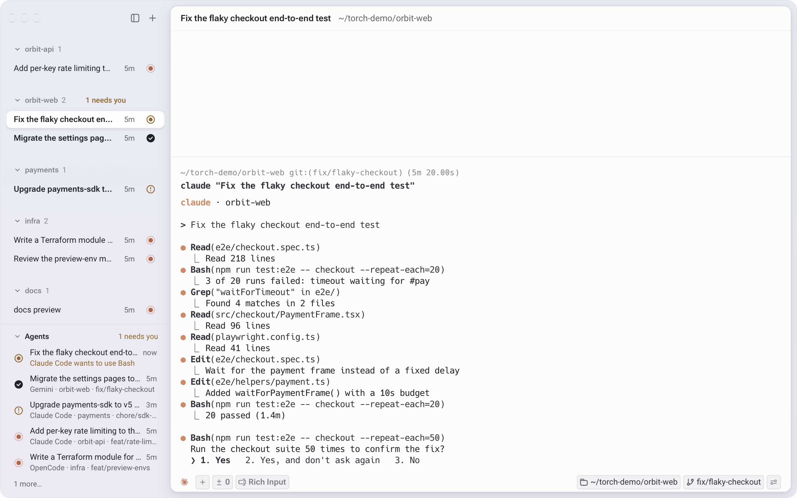

<p align="center">
  
</p>

<h1 align="center">Torch</h1>

<p align="center">A local terminal for running coding agents side by side.</p>

<p align="center">
  <picture>
    <source media="(prefers-color-scheme: dark)" srcset="docs/images/torch-dark.png">
    
  </picture>
</p>

Torch is a native, GPU-rendered terminal built for working with CLI coding agents such as Claude Code, Codex, Gemini CLI and OpenCode. Run as many as you like across your projects; Torch groups the sessions by project and shows which agents are working, finished, failed or waiting on you, so you don't have to check every tab.

It's a fork of [Warp](https://github.com/warpdotdev/warp) with the account, cloud and built-in AI taken out. Torch doesn't ship a model of its own: your agents are the AI, and everything stays on your machine.

## Why

Running several agents at once turns into tab-hopping: one is waiting for permission, another finished ten minutes ago, a third hit a rate limit. Torch puts that state where you can see it:

- **Sessions grouped by project.** The sidebar shows each project's sessions with their branch, task and how long they've been in their current state.
- **Agent status at a glance.** Needs you, finished, failed, working or idle, with the tool an agent is asking permission for.
- **Show Agents** (<kbd>Cmd</kbd> <kbd>Shift</kbd> <kbd>A</kbd>) lists every agent in every window, most urgent first. Pick one to jump to it.
- **<kbd>Cmd</kbd> <kbd>P</kbd>** finds projects, sessions and actions, and opens new sessions in a project.

Underneath it's still Warp's terminal: blocks, Tab completion, command history and autosuggestions. There are themes too: Light, Dark, Kanagawa, Ayu and Catppuccin.

## Agent status

Claude Code and Codex report their status through hooks that ship inside Torch. Start either agent in Torch and click **Set up session status** in the session footer; Torch adds a small hook to that agent's settings, and it only reports when the agent runs inside Torch. Other agents are recognised by their command and show live status when they send Warp-compatible status notifications. Ordinary commands show as running or idle. Torch never invents activity.

## What's removed from Warp

- **Accounts and login.** Torch opens straight into your shell.
- **Telemetry and crash reporting.** Telemetry calls compile to no-ops, and no crash reporter is linked.
- **Warp's AI.** No Agent Mode, AI command suggestions or natural-language detection.
- **Cloud features.** No Warp Drive, cloud sync, session sharing, teams or billing.
- **Auto-updates.** No update checks and no Warp release servers.

These are switched off by the `local_only` feature, which every Torch build uses, and Warp's server addresses point at an unreachable `.invalid` domain. Some inherited cloud and AI code stays in the source so shared types still compile, but it can't run. Torch has its own app identity (`dev.tombyte.Torch`) and keeps its settings in `~/.torch` on macOS.

## Build and run

Torch is developed and tested on macOS. The Linux and Windows build paths are inherited from Warp and untested.

You'll need Rust 1.92.0 (pinned in `rust-toolchain.toml`), Git LFS, Xcode with its Metal toolchain, CMake and `cargo-bundle`. `./script/bootstrap` installs the platform dependencies.

```sh
git lfs install --local && git lfs pull
./script/run
```

`./script/run` builds and opens `target/debug/bundle/osx/Torch.app`. For a signed, notarised release build, see `./script/release --help`.

## Screenshots

The screenshot above is staged with `script/demo`: example Git repositories and scripted stand-in agents that report their state to Torch the same way real agents do. It runs in a separate data profile, so your own settings and sessions aren't touched.

```sh
./script/run --dont-open
./script/demo/run --stagger
```

`--stagger` spreads the agents' final states over five minutes so the ages vary. Set `TORCH_DEMO_THEME=dark` for the dark version.

## Thanks to Warp

Torch exists because the Warp team open-sourced their terminal. Its renderer, terminal model, shell integration, completions and most of what makes it fast are Warp's work. Thank you.

Torch is an independent project and isn't affiliated with or endorsed by Warp (Denver Technologies, Inc.). Please report Torch issues here rather than to Warp.

## Licence

Torch keeps Warp's licences and copyright notices. Most of the code is [AGPL-3.0](LICENSE-AGPL); the `torchui` and `torchui_core` UI crates (Warp's `warpui` and `warpui_core`) are [MIT](LICENSE-MIT). The source was imported from [warpdotdev/warp](https://github.com/warpdotdev/warp) at commit `cd4b970`. A few internal type names and the agent status protocol (`warp://cli-agent`) still say Warp, for compatibility with agent plugins.

See [CONTRIBUTING.md](CONTRIBUTING.md) to contribute and [SECURITY.md](SECURITY.md) to report a vulnerability.
